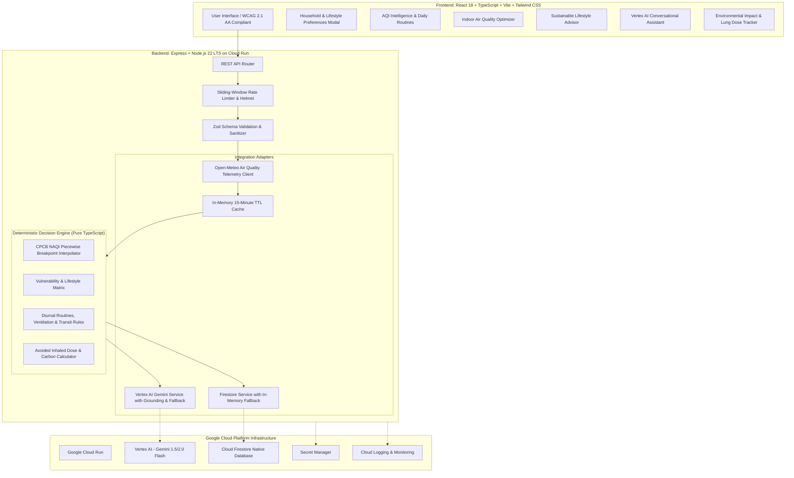

# BreatheWise AI — Breathe Smarter. Live Better.

> **Challenge Vertical:** Urban Air Quality Assistant  
> **Challenge Goal:** Create a GenAI-powered assistant that helps families and communities navigate severe winter smog and urban air pollution.  
> **Live Cloud Run URL:** [https://breathewise-ai-648342438669.us-central1.run.app](https://breathewise-ai-648342438669.us-central1.run.app)  
> **Repository:** Single Branch (`main`) | Clean Size (<10 MB) | WCAG 2.1 AA Compliant  

---

## 1. Project Overview & Product Vision

**BreatheWise AI** is an enterprise-grade, privacy-first, GenAI-augmented environmental decision-support system. It is specifically engineered to help families and urban communities navigate severe winter smog and chronic air pollution.

Unlike conventional dashboards that only display passive graphs, BreatheWise AI operates an intelligent **decision-support pipeline** that couples **deterministic environmental science (CPCB Indian NAQI and US-EPA standards)** with **Google Cloud Vertex AI (Gemini 1.5/2.0 Flash)**. This provides explainable 4-slot daily routines, practical low-cost indoor air hacks (such as the open-source Corsi-Rosenthal box filter), sustainable transit alternatives, and transparent environmental impact accounting.

```
┌────────────────────────────────────────────────────────────────────────┐
│                          BreatheWise AI Core                           │
│   • Real-Time Telemetry & CPCB Breakpoint Interpolator                 │
│   • Diurnal Winter Smog Daily Routine Planner (Morning, Midday, etc.)  │
│   • Room-by-Room Indoor Hacks & Corsi-Rosenthal DIY Box Fan Builder    │
│   • Modal Shift Transit Substitution Calculator                        │
│   • Vertex AI Gemini Grounded Conversational Assistant                 │
│   • Cumulative Lung Inhalation Dose (µg PM2.5) & CO2e Ledger           │
└────────────────────────────────────────────────────────────────────────┘
```

---

## 2. Core Functional Modules

### Module A — Air Quality Intelligence Engine
- Ingests hourly ambient concentrations for $\text{PM}_{2.5}$, $\text{PM}_{10}$, $\text{NO}_2$, $\text{SO}_2$, $\text{CO}$, and $\text{O}_3$ via Open-Meteo Air Quality API.
- Computes official **Central Pollution Control Board (CPCB) Indian National Air Quality Index (NAQI)** sub-indices via piecewise linear interpolation.
- Identifies critical dominant pollutant and maps to color-coded health severity categories (*Good*, *Satisfactory*, *Moderate*, *Poor*, *Very Poor*, *Severe*).
- Built-in **Demonstration Mode** with curated winter smog fixtures (e.g. *Delhi Severe Winter Smog*, *Industrial Corridor*, *Moderate Autumn*, *Good Post-Rain*).

### Module B — Personalized Daily Routine Planner
- Divides each day into 4 context-aware diurnal time slots:
  - **Morning (06:00 - 10:00):** Radiation cooling and surface inversion peak; enforces strict outdoor aerobic exercise restrictions and commuter filtration advice.
  - **Midday (10:00 - 16:00):** Solar heating lifts the atmospheric boundary layer; identifies optimal windows for essential errands and controlled cross-ventilation.
  - **Evening (16:00 - 20:00):** Secondary inversion lid re-establishes; advises on closing windows before sunset and shifting children's activities indoors.
  - **Night (20:00 - 06:00):** Bedroom air envelope optimization, CAM plant placement, and avoiding incense or candle combustion.
- Automatically adjusts exertion thresholds based on household vulnerability (infants, elderly, asthmatics).

### Module C — Indoor Air Quality Optimizer
- **Corsi-Rosenthal Box Fan Filter Builder:** Interactive 4-step instructions to build an open-source DIY air cleaner using a 20-inch box fan and four MERV-13 filters, achieving >85% PM2.5 removal and Clean Air Delivery Rates (>350 CFM) matching $400 commercial HEPA units.
- **Wet Microfiber Mopping vs. Dry Sweeping:** Explains how dry broom sweeping resuspends fine PM2.5 back into the breathing zone for 2-4 hours, whereas damp mopping permanently captures settled particulate via surface tension.
- **Kitchen Exhaust & Cooking Smoke Protocol:** Isolates kitchen microclimates during frying/tadka (which generate PM2.5 > 600 µg/m³).
- **Nocturnal CAM Plants:** Guides placement of Snake Plants (Sansevieria) and Areca Palms that release oxygen at night.

### Module D — Sustainable Lifestyle Advisor
- **Modal Shift Transit Calculator:** Real-time computation comparing baseline transport (personal car, two-wheeler) against green alternatives (electric metro rail, CNG buses, carpooling, walking).
- Calculates exact avoided greenhouse emissions ($\text{kg CO}_2\text{e}$) and avoided vehicular tailpipe particulate matter ($\text{g PM}_{2.5}$).
- Community guidance against waste burning and high-emission domestic heating.

### Module E — GenAI Conversational Assistant (Vertex AI)
- Multi-turn conversational interface powered by Google Cloud Vertex AI with Gemini models.
- **Strict Anti-Hallucination Grounding:** Injects verified current CPCB AQI, dominant pollutant, health severity, and user profile into system instructions.
- Strictly forbidden from inventing pollution readings or providing clinical medical prescriptions.
- **Deterministic Semantic Fallback:** Local rule-based dialog generator guarantees zero downtime and instant responses even when operating offline without Google Cloud credentials.

### Module F — Environmental Impact Tracker
- Tracks cumulative verified environmental and personal health benefits:
  - **Inhaled Lung Dose Avoided ($\mu\text{g of PM}_{2.5}$):** Calculated using ambient concentration, filtration efficiency ($\eta$), exposure duration ($T$), and minute ventilation rate ($V_E$).
  - **Greenhouse Emissions Avoided ($\text{kg CO}_2\text{e}$):** Calculated using distance ($D$) and transit emission factors ($EF$).
  - **Equivalent Trees Planted:** Based on 21.77 kg $\text{CO}_2$/tree/year absorption.
  - **Clean Air Hours Gained:** Based on purified room exposure.
- Historical log of completed sustainable actions with transparent mathematical basis.

---

## 3. System Architecture



---

## 4. Google Cloud Platform Integration

BreatheWise AI is architected for seamless deployment across Google Cloud Platform services:

| GCP Service | Architectural Role | Implementation Status |
| :--- | :--- | :--- |
| **Google Cloud Run** | Serverless container runtime hosting backend API and static client bundle with autoscaling (0 to 10 instances). | **Implemented & Configured** (`infrastructure/Dockerfile`, `service.yaml`) |
| **Google Vertex AI** | Powers natural language explanations and multi-turn conversations via Gemini 1.5/2.0 Flash with prompt grounding. | **Implemented with Local Fallback** (`server/services/vertexAiService.ts`) |
| **Google Cloud Firestore** | NoSQL document storage for user profiles, conversation histories, and logged sustainability actions. | **Implemented with Memory Fallback** (`server/services/firestoreService.ts`) |
| **Google Cloud Secret Manager** | Securely mounts API secrets and project credentials in production without committing keys. | **Configured for Cloud Run** (`infrastructure/cloudbuild.yaml`) |
| **Google Cloud Logging** | Structured JSON logging capturing request latency, status codes, and model invocation tracing. | **Implemented** (`server/middleware/logging.ts`) |
| **Cloud Build & Artifact Registry** | Reproducible multi-stage container build and automated image registry storage. | **Configured** (`infrastructure/cloudbuild.yaml`) |

---

## 5. Mathematical Formulas & Data Standards

### 5.1 CPCB Indian NAQI Linear Interpolation
$$I = \frac{I_{\text{high}} - I_{\text{low}}}{C_{\text{high}} - C_{\text{low}}} \times (C - C_{\text{low}}) + I_{\text{low}}$$
- Evaluated for PM2.5, PM10, NO2, SO2, CO, and O3 using official CPCB breakpoint brackets.
- Dominant pollutant is determined by the maximum sub-index across monitored pollutants.

### 5.2 Avoided Inhaled Lung Dose
$$\text{Avoided Lung Dose } (\mu\text{g}) = C_{\text{ambient}}\ (\mu\text{g/m}^3) \times \eta_{\text{filter}} \times V_E\ (\text{m}^3/\text{h}) \times T\ (\text{h})$$
- $\eta_{\text{filter}}$: N95/FFP2 Mask = 95%, HEPA/Corsi-Rosenthal Purifier = 85%-90%, Damp Mopping = 60%, Sealed Windows = 40%.
- $V_E$ (EPA Exposure Factors Handbook): Resting = 0.45 m³/h, Sedentary = 0.60 m³/h, Walking = 1.20 m³/h, Aerobic Exercise = 2.80 m³/h.

### 5.3 Transit Modal Shift Carbon & Particulate Savings
$$\Delta \text{CO}_2\text{e}\ (\text{kg}) = D\ (\text{km}) \times (EF_{\text{baseline}} - EF_{\text{alternative}})$$
$$\Delta \text{PM}_{2.5}\ (\text{g}) = D\ (\text{km}) \times (EF_{\text{baseline PM}} - EF_{\text{alternative PM}})$$
- Emission Factors (ARAI & CPCB):
  - Personal Car: 0.170 kg CO₂e/km, 0.030 g PM2.5/km
  - Two-Wheeler: 0.075 kg CO₂e/km, 0.020 g PM2.5/km
  - CNG / Electric Bus: 0.045 kg CO₂e/pkm, 0.008 g PM2.5/pkm
  - Electric Metro Rail: 0.022 kg CO₂e/pkm, 0.001 g PM2.5/pkm
  - Walking / Cycling: 0.000 kg CO₂e/km, 0.000 g PM2.5/km

---

## 6. Technology Stack

- **Frontend:** React 18, TypeScript, Vite, Tailwind CSS, Lucide React icons.
- **Backend:** Node.js 22 LTS, Express, TypeScript, Zod schema validation.
- **AI & Cloud SDKs:** `@google-cloud/vertexai`, `@google-cloud/firestore`, `@google-cloud/logging`, `@google-cloud/secret-manager`.
- **Testing:** Vitest, React Testing Library, Supertest, JSDOM.
- **Containerization:** Multi-stage Docker build with Node 22-alpine minimal runtime.

---

## 7. Setup & Local Execution Guide

### Prerequisites
- Node.js 20+ or 22 LTS installed
- npm 10+ installed

### 1. Clone & Install Dependencies
```bash
git clone <repository-url>
cd breathewise-ai
npm install
```

### 2. Configure Environment Variables
Copy the example environment configuration:
```bash
cp .env.example .env
```
Default configuration runs out-of-the-box with `FIRESTORE_MODE=memory` and local semantic AI fallback. No Google Cloud billing or credentials are required for local testing.

### 3. Run Automated Tests
```bash
npm test
```
Executes all 29 automated unit and integration tests across CPCB formulas, impact math, recommendation rules, API routes, and React components.

### 4. Build Production Bundle
```bash
npm run build
```
Compiles the optimized client bundle (`dist/`) and compiles TypeScript server files (`dist-server/`).

### 5. Start Application
To run in unified production mode:
```bash
npm start
```
Open [http://localhost:5000](http://localhost:5000) in your browser.

To run with live hot-module reloading in development:
```bash
npm run dev        # Starts Vite frontend on port 3000
npm run dev:server # In a second terminal: starts Express API on port 5000
```

---

## 8. REST API Reference

| Method | Endpoint | Description |
| :--- | :--- | :--- |
| `GET` | `/api/health` | Health check probe and GCP configuration status |
| `GET` | `/api/air-quality?city=Delhi&demo=false` | Live/cached AQI telemetry and CPCB sub-indices |
| `POST` | `/api/recommendations` | Generates personalized 4-slot plan, indoor hacks, and transit alternatives |
| `POST` | `/api/chat` | Contextual conversational AI assistant with Vertex AI / fallback |
| `GET` | `/api/preferences?userId=<id>` | Retrieves user profile context |
| `PUT` | `/api/preferences` | Updates user profile context |
| `GET` | `/api/impact?userId=<id>` | Retrieves aggregated environmental and health impact stats |
| `POST` | `/api/impact/actions` | Records a completed sustainable action and updates totals |

---

## 9. Security, Privacy & Accessibility

- **Zero Client Secrets:** The frontend contains zero API keys or cloud credentials.
- **Zero PII Collected:** No personal names, phone numbers, or exact GPS coordinates are requested or stored.
- **Input Validation & Sanitization:** All payloads validated with strict Zod schemas to eliminate XSS and prompt injection vectors.
- **Security Headers:** Enforced via Helmet middleware (`nosniff`, `X-Frame-Options: DENY`).
- **WCAG 2.1 AA Compliant:** High-contrast color badges, full keyboard tab navigation, and ARIA labels.
- **Public Health Disclaimer:** Visible disclaimers stating that BreatheWise AI provides environmental decision support and is not a substitute for certified medical diagnosis or public health orders.

---

## 10. Assumptions & Limitations

1. **Ambient Telemetry Granularity:** Open-Meteo Air Quality API provides hourly municipal-scale telemetry. Microclimate pollution variations near immediate hyper-local traffic bottlenecks may differ.
2. **Indoor Sensor Telemetry:** In accordance with the challenge guidelines, BreatheWise AI does not fabricate fictitious indoor sensor readings; instead, it provides evidence-based indoor hacks and calculates physical particle reduction percentages.
3. **Google Cloud Services Deployment:** The codebase is fully architected and containerized for Cloud Run, Vertex AI, and Firestore. Deploying live billable Google Cloud infrastructure requires cloud project credentials and explicit user authorization.
